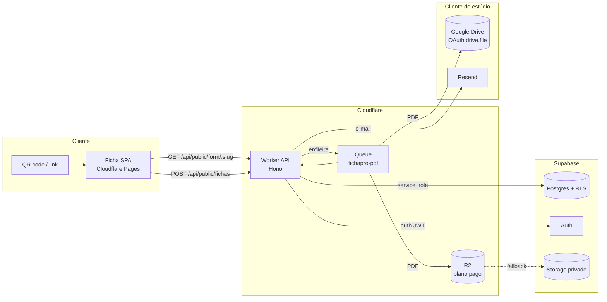

# Arquitetura

## Visão geral



## Fluxo de uma ficha

1. O estúdio imprime um QR code apontando para `https://app/f/{slug}`.
2. A SPA busca a configuração pública: tenant, template, formulário ativo, profissionais e branding.
3. O cliente preenche no celular. A engine renderiza os campos a partir de `campos_json`, aplica máscaras, comprime imagens, calcula idade e libera a seção do responsável quando necessário.
4. No fim, o cliente aceita o termo/LGPD e assina no canvas.
5. A SPA envia um JSON (dados + assinaturas + consentimentos + chave de idempotência).
6. O Worker:
   - valida no servidor com o mesmo módulo compartilhado;
   - calcula HMAC do CPF;
   - criptografa o payload com AES-256-GCM;
   - grava `fichas`, `assinaturas`, `consentimentos`, `ficha_anexos` e `eventos`;
   - enfileira `{ fichaId }` e responde com o protocolo.
7. O consumer da fila:
   - envia anexos pendentes ao storage (Drive ou R2);
   - gera o PDF com `pdf-lib`;
   - calcula SHA-256 do PDF;
   - salva em `${tenantId}/${fichaId}/...`;
   - atualiza `status = salva`, `hash_pdf`, `drive_file_id`/`r2_key` e o funil.
8. O painel lê as fichas via RLS, descriptografa o payload no Worker e permite baixar o PDF.

## Multi-tenancy

- Uma tabela `tenants`; todas as tabelas de dados carregam `tenant_id`.
- RLS habilitado em todas as tabelas. `current_tenant_id()` resolve o tenant por:
  1. claim `tenant_id` do JWT (custom access token hook);
  2. fallback: linha em `usuarios` para `auth.uid()`.
- O cliente autenticado usa a **anon key + JWT**; o Worker público usa **service_role** e nunca devolve dados de outro tenant.
- Escritas públicas (ficha) passam exclusivamente pela API; não há policy de INSERT anônimo em `fichas`.
- Acesso a segredos do Drive (`tenant_secrets`) é bloqueado para `anon/authenticated`; só o Worker com service_role lê.

### Teste de isolamento

O roteiro de QA deve criar dois tenants A e B, autenticar como A e tentar:

```sql
select * from public.fichas;                    -- só A
select * from public.formularios;               -- só A
select * from public.assinaturas;               -- só A
select * from public.tenants;                   -- só A
select * from public.tenant_secrets;            -- 0 linhas / erro
select * from public.fichas where tenant_id = 'id-de-B'; -- 0 linhas
```

Qualquer linha de B é falha crítica de release.

## Modelo de dados (resumo)

| Tabela | Papel | RLS |
|---|---|---|
| `templates` | Catálogo global por nicho | leitura pública dos ativos |
| `tenants` | Estúdio/clínica | select/update do próprio owner |
| `usuarios` | Membros do tenant | select do tenant; update limitado |
| `tenant_secrets` | Tokens OAuth do Drive | sem policy (service_role) |
| `formularios` | Quais campos do template o tenant usa | CRUD do tenant/owner |
| `fichas` | Registro da ficha | select do tenant; escrita via API |
| `ficha_anexos` | Documento, autorização, foto, liberação | select do tenant |
| `assinaturas` | Imagem + hash + IP + UA + timestamp | select do tenant |
| `consentimentos` | Termo, LGPD e extras | select do tenant |
| `eventos` | Funil e observabilidade | select/insert do tenant |
| `webhook_eventos` | Idempotência de billing | service_role |

## Engine de formulário

A ficha é uma SPA estática com uma engine única:

- Passos = seções do template + Termo + Revisão + Assinatura.
- Tipos: `text`, `textarea`, `date`, `cpf`, `tel`, `email`, `number`, `sim_nao`, `checkbox`, `select`, `upload`.
- Condicionais:
  - `tipo: menor_idade` (seção do responsável);
  - `tipo: parq_positivo` (liberação médica do fitness);
  - `campo` + `operador` (`igual`, `contem`, `preenchido`, ...).
- `campos_ativos` permite ao tenant esconder/reordenar seções e campos sem deploy.
- O mesmo módulo de validação (`packages/shared`) roda no browser e no Worker.

## Assinatura e trilha probatória

No momento da assinatura, o servidor calcula:

```
hash_conteudo = SHA-256(JSON canônico({
  tenant, template, versao, dados_sem_arquivos,
  consentimentos, papeis_assinados, assinado_em
}))
```

O PDF inclui:

- texto do termo e da LGPD aceitos;
- nome e CPF mascarado do signatário;
- imagem da assinatura;
- data/hora, IP e user-agent;
- hash do conteúdo assinado;
- protocolo, versão do template e página X de Y.

Depois de gerado, o Worker calcula `hash_pdf = SHA-256(bytes)` e guarda em `fichas.hash_pdf`. O hash do PDF não entra dentro do próprio PDF (autorreferência impossível); a verificação é feita comparando o arquivo baixado com o hash no banco.

## Storage híbrido

Interface única:

```ts
interface StorageAdapter {
  upload({ key, bytes, contentType, fileName, pastas }): Promise<{ key, externalId?, url? }>;
  download({ key?, externalId? }): Promise<{ bytes, contentType } | null>;
  delete({ key?, externalId? }): Promise<void>;
}
```

- **R2**: chave `${tenantId}/${fichaId}/${arquivo}`.
- **Drive**: pasta `FichaPro - {negócio}` → `AAAA-MM` → arquivo. Escopo `drive.file` (o app só vê o que criou).
- Se o Drive falhar ou for desconectado, o tenant pode voltar para R2 (plano pago) sem mudar o código da ficha.

## Assíncrono e resiliência

- `POST /api/public/fichas` responde em ~1 requisição, sem gerar PDF.
- Fila com `max_retries = 3` e DLQ.
- `status`: `preenchida → salva` ou `erro`.
- Cron diário:
  - expurgo por retenção;
  - reenfileiramento de fichas presas (`preenchida`/`erro`, < 5 tentativas).
- Idempotência:
  - `meta.idempotencia` + índice único `(tenant_id, idempotency_key)`;
  - webhooks de billing em `webhook_eventos`.

## Observabilidade

Eventos de funil gravados em `eventos`:

`ficha_preenchida` → `pdf_gerado` → `pdf_salvo`; falhas em `erro`; enfileiramento em `pdf_enfileirado_erro`.

Sentry é chamado via Envelope API sem SDK. Alertas recomendados:

- taxa de `erro` > 2% em 1h;
- fila com mensagens > 5 min;
- tenant em trial expirando;
- falha de renovação do token do Drive.

## Limites conhecidos do MVP

- Um login pertence a um tenant (ADR 0006).
- O painel MVP está implementado em `apps/painel`; faltam convite de equipe, billing completo e export ZIP.
- Billing tem receptor idempotente e mapeamento por `metadata.tenant_id`, mas o fluxo completo de checkout/dunning é o próximo incremento.
- Expurgo apaga linhas do banco; a limpeza dos objetos no storage precisa de lifecycle rule (R2) ou é responsabilidade do cliente no Drive.
- Não há ICP-Brasil; a assinatura é eletrônica simples com trilha de auditoria.
